# Rukn Al Yaqeen website and CMS

## How the pieces connect

```mermaid
flowchart LR
  Owner["Business owner"] -->|"Edit, approve, publish"| Studio["Sanity Studio<br/>cms.rysetup.com"]
  Studio -->|"Save content"| Dataset["Sanity project ryikque3<br/>production dataset"]
  Dataset -->|"Signed event for approved published content"| Receiver["Webhook receiver<br/>deploy.rysetup.com"]
  Receiver -->|"Request workflow with an event ID"| Actions["GitHub Actions<br/>Deploy approved Sanity content"]
  Actions -->|"Push deployment marker"| Main["GitHub main<br/>alifarah345/rysetup"]
  Main -->|"Push triggers build"| Build["Hostinger Astro build"]
  Dataset -->|"Read approved published content at build time"| Build
  Build -->|"Serve static pages"| Site["rysetup.com<br/>English and Arabic"]
  Visitor["Website visitor"] --> Site
  Site -->|"Consultation and service inquiry"| Forms["Web3Forms"]
  Forms -->|"Send notification with visitor Reply-To"| Inbox["info@rysetup.com"]
```

Saving a draft keeps the edit in Sanity. Publishing approved content starts an automated build. The receiver validates Sanity's signature. GitHub Actions writes a marker commit to `main`, and Hostinger builds the site using the approved content. The separate CMS and receiver deployments only need updates when their own code or settings change. Hostinger's manual redeploy is available if a content build fails.

## Where to look

| Task | Location |
| --- | --- |
| Change bilingual page copy, FAQs, or public contact details | [Sanity Studio](https://cms.rysetup.com/) |
| Investigate Sanity delivery | Sanity Manage → Rukn Al Yaqeen → API → Webhooks → Attempt log |
| See whether GitHub committed a content update | [GitHub Actions](https://github.com/alifarah345/rysetup/actions) and [the marker workflow](../.github/workflows/sanity-publish.yml) |
| Check receiver startup or dispatch errors | Hostinger → deploy.rysetup.com → Runtime logs and [receiver setup](../integrations/sanity-deploy/README.md) |
| Verify the production build | Hostinger → rysetup.com → Deployments, then the relevant English and Arabic pages |
| Verify an inquiry | Web3Forms and the info@rysetup.com inbox |
| Review the full roadmap | [ROADMAP.md](../ROADMAP.md) |
| Review owner preferences and release approvals | [AGENTS.md](../AGENTS.md) |

## GitHub and hosting boundaries

GitHub contains the website source, bilingual seed generator, Studio schema, and webhook automation. The signed-in Studio import was a one-time build. The actual content documents and revisions are stored in Sanity. Hosting variables, private Sanity credentials, the signing secret, GitHub dispatch token, and provider configuration are managed in their respective dashboards.

The handoff branch records the Studio editor registration and receiver diagnostic logging. The diagnostic ZIP was prepared locally during troubleshooting. The separate SMTP inquiry prototype remains in the local workspace. The live lead path uses Web3Forms.

## Launch checklist
The live check on November 24, 2026 found temporary test words in the English Terms body. Search indexing is blocked by robots.txt and the sitemap has zero URLs. Remove the test words and verify the next automatic build before opening the site to search engines.

1. Confirm the bilingual service and package offers in Sanity. Review the Privacy Policy and Terms with the owner and verify the live result after publishing.
2. Add the WhatsApp number in Sanity once it is ready. Test the correct account and localized message in English and Arabic.
3. Verify the production indexing flags, robots.txt, and sitemap after content sign-off. Submit the sitemap through Google Search Console and inspect the English and Arabic URLs.
4. Approve the consent setup and add GA4. Verify the form event semantics before enabling Google Ads or Meta conversions. A WhatsApp click is an engagement event. Web3Forms acceptance and inbox delivery are separate checks.
5. Begin Phase 2 with CRM destination, ownership, qualification, and follow-up rules once lead capture and launch checks are complete.
